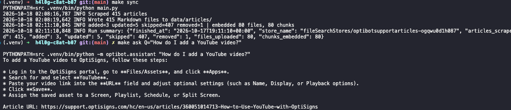

# OptiBot mini-clone

Scrapes the OptiSigns help center, converts articles to Markdown, and keeps a Gemini File Search store
in sync for a support assistant (Gemini API + File Search). Design details: [docs/architecture.md](docs/architecture.md).

## Setup & run

```bash
cp .env.sample .env      # fill GEMINI_API_KEY; leave FILE_SEARCH_STORE empty on first run
make install
make sync                # first run prints the new store name -> put it in .env
make ask Q="How do I add a YouTube video?"
make test lint

docker build -t optibot-sync . && docker run --rm -e API_KEY=... -e FILE_SEARCH_STORE=... optibot-sync main.py
```

## Assistant

The assistant is defined in code ([service.py](src/optibot/assistant/service.py)): the system prompt is the
verbatim one from the brief, and the File Search store is attached as a `file_search` tool via the API.
It uses `GEMINI_MODEL` (default `gemini-3.8-flash`) and falls back to `gemini-3.7-flash` only on a 503 overload.

## Chunking

Articles are split at headings and packed into pieces of ≤ 400 tokens; each piece repeats the title and
`Article URL:` so any retrieved chunk can be cited. Each piece is uploaded as its own document with a
512-token (Gemini's maximum) / 0-overlap chunking config, so **one document = one chunk** and the logged
chunk count follows.

## Daily job

[`daily-sync.yml`](.github/workflows/daily-sync.yml) runs the Docker image on GitHub Actions at 02:00 UTC.
It re-scrapes, compares each article's SHA-256 with the one stored in the File Search store, uploads only the
delta and logs `added / updated / skipped / removed` plus files and chunks embedded.

- Job logs: [daily-sync runs](https://github.com/nguyenhoanglong1006/h4l0g-c8at-b07/actions/workflows/daily-sync.yml)
- Last-run artefact: `last-run` on each run page (`last_run.json` + the Markdown files)

## Sample answer

A local delta run (415 articles: 3 added, 5 updated, 407 skipped, 1 removed; 80 files / 80 chunks embedded),
then the sample question answered with a cited `Article URL:`.



## What I cut

- Chunk counts are derived (one piece = one chunk by construction), not read back from the API.
- No tests for the HTTP scraper and the job wiring; tests cover conversion, chunking, delta planning and the assistant.
- Images stay as links to Zendesk attachments; they are not downloaded or described.
